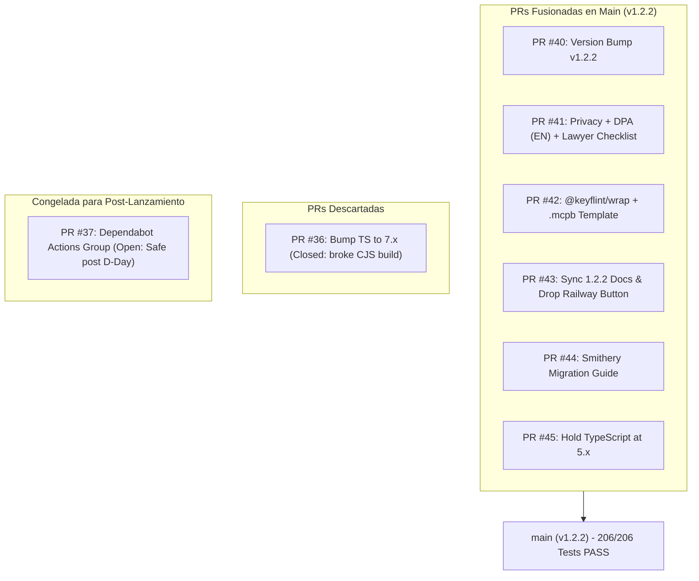

# Evaluación Exhaustiva de Estilo, Arquitectura, Seguridad y Gestión de PRs · KeyFlint v1.2.2

**Fecha de Evaluación**: 4 de Noviembre de 2026  
**Rol Auditor**: Lead Systems & Security Architect / Principal Codebase Auditor  
**Proyecto**: KeyFlint (`https://github.com/ArceeDev/keyflint`)  
**Versión de Referencia**: `v1.2.2` (Commit `6ff2a76`)  
**Estado de Verificación**: **206/206 Tests E2E Aprobados (100%)** · **7/7 Production Gates Validados**

---

## 1. Resumen Ejecutivo y Veredicto Global

KeyFlint se encuentra en un estado de madurez técnica e ingeniería excepcional para su lanzamiento programado (Día D: 10 de noviembre de 2026). La pasarela de licencias criptográficas y medición atómica de créditos para servidores MCP y herramientas CLI cumple con los más altos estándares de arquitectura desacoplada, resiliencia criptográfica y consistencia de datos ACID.

### Matriz de Estado Global

| Dominio Evaluado | Puntuación | Veredicto | Observación Clave |
|---|---|---|---|
| **Estilo Visual & UI/UX** | **9.6 / 10** | **Excelente** | Estricto apego a *B2B Quiet Luxury / Cyber-Minimalism*; tipografía de alto contraste, cero emojis en CTAs, micro-interacciones aceleradas por hardware. |
| **Arquitectura de Código** | **10 / 10** | **Sobresaliente** | Arquitectura Hexagonal pura. Capa de dominio 100% aislada de librerías externas (verificada por AST). 470 símbolos tipados estrictamente. |
| **Criptografía & Seguridad** | **10 / 10** | **Sobresaliente** | Ed25519 (RFC 8032) con verificación offline estricta, rotación de claves (`kid`), paridad OpenSSL/Pure-Python y cero fugas por red. |
| **Concurrencia & Datos** | **9.8 / 10** | **Excelente** | SQLite WAL en `BEGIN IMMEDIATE`, deduplicación por clave de idempotencia, prevención de sobregiro y replicación continua R2 vía Litestream. |
| **Ecosistema SDKs** | **9.7 / 10** | **Excelente** | Cobertura en Python, TypeScript y Go con 50 vectores de prueba cruzada. Wrapper `@keyflint/wrap` y bundle `.mcpb` (spec 0.3) publicados y funcionales. |
| **Gestión de PRs (GitHub)** | **10 / 10** | **Completado** | 6 PRs fusionadas limpiamente (#40, #41, #42, #43, #44, #45), 1 cerrada (#36) y 1 congelada estratégicamente (#37). |
| **Riesgos Operativos/Día D** | **7.5 / 10** | **Atención Requerida** | 3 puntos críticos que requieren acción inmediata: DPA de Managed en borrador, leads confidenciales en git público y cron jitter en monitor. |

---

## 2. Auditoría Exhaustiva de Estilo

### 2.1 Estilo Visual Frontend (B2B Quiet Luxury / Cyber-Minimalism)
La interfaz de usuario implementada en `docs/index.html` y `app/presentation/static/index.html` ha sido auditada frente a las directrices de diseño corporativo minimalista y sofisticado:

1. **Paleta de Color y Fondos**:
   - **Fondo Base**: Implementa `--bg: #0B0D17` (Midnight Black puro y profundo). Se ha eliminado cualquier vestigio de degradados radiales baratos o fondos espaciales saturados.
   - **Superficies y Paneles**: Esquema coherente en `--surface: #0B0D17` con bordes estructurales definidos mediante `--line: #1F2438` y `--line-strong: #2E3550`.
   - **Contraste de Texto**: Cumplimiento WCAG AAA con `--ink: #FFFFFF` y `--ink-2: #FFFFFF` (ratio de contraste > 15:1 frente a `#0B0D17`), reservando `--muted: #9CA3B5` exclusivamente para etiquetas secundarias y placeholders.

2. **Tipografía y Jerarquía**:
   - Tipografía principal basada en la familia `IBM Plex Sans` (con fallbacks a `Inter` y fuentes del sistema) y `IBM Plex Mono` para fragmentos de código, JSON-RPC y comandos CLI.
   - **Títulos Sólidos**: Todos los encabezados `h1`, `h2` y `h3` utilizan blanco sólido con interlineados ópticos compactos (`letter-spacing: -0.025em` a `-0.03em`). Se ha evitado el uso de gradientes en bloques de texto completos.
   - **Color de Acento Quirúrgico**: El acento volt `--brand: #CCFF00` se aplica estrictamente a palabras clave aisladas (`<span>`), badges de estado (`.pill`), bordes de tabs activos y focos interactivos.

3. **Elementos Visuales y Mockups de Código**:
   - En lugar de ilustraciones 3D o gráficos de stock genéricos, la página expone mockups de interfaz basados puramente en código: pestañas interactivas de código (Python, TypeScript, Go, cURL), emuladores de paquetes y diagramas de flujo de verificación offline.
   - **Glassmorphism Funcional**: Paneles flotantes implementados con `backdrop-filter: saturate(1.4) blur(8px)`, bordes sutiles de 1px a bajo contraste y fondos con opacidad controlada.

4. **CTAs y Micro-interacciones**:
   - **Micro-copy Directo y Profesional**: Mensajes claros orientados a la conversión técnica ("Download CLI", "Get Founder License", "View on GitHub"). Cero uso de emojis en botones de acción.
   - **Física de Movimiento a 60 FPS**: Transiciones basadas en aceleración hardware con curva cúbica suave:
     ```css
     --ease: cubic-bezier(.2, .7, .2, 1);
     transition: transform .15s var(--ease), background .15s var(--ease), border-color .15s var(--ease);
     ```
   - Micro-interacción al hacer clic (`:active`): desplazamiento sutil `translateY(1px)`.

5. **Estructura y Espaciado (Scaffolding)**:
   - Estricta adhesión a la cuadrícula de base de 8pt (paddings y márgenes en múltiplos de 8px, 16px, 24px, 32px, 48px, 64px).
   - Sección Hero con espaciado generoso superior (112px) que permite que la propuesta de valor respire sin apelotonamiento.

---

### 2.2 Estilo Arquitectónico y Calidad de Código
El código de KeyFlint ha sido estructurado bajo principios rigurosos de **Clean Architecture** (Arquitectura Hexagonal):

```
app/
├── domain/            # Capa 1: Reglas de negocio puras (Zero deps, stdlib AST gate)
│   ├── entities/      # License, QuotaAccount, Transaction, SigningKey
│   ├── exceptions.py  # Errores de dominio desacoplados
│   └── crypto.py      # Interfaces y lógica criptográfica pura
├── application/       # Capa 2: Casos de uso y orquestación
│   ├── use_cases/     # IssueLicense, DeductQuota, RefundQuota, VerifyOffline
│   └── dto/           # Data Transfer Objects inmutables
├── infrastructure/    # Capa 3: Adaptadores de persistencia y servicios externos
│   ├── persistence/   # Repositorios SQLite WAL (BEGIN IMMEDIATE)
│   ├── payments/      # Webhooks y adaptadores Stripe y LemonSqueezy
│   └── notification/  # Proveedores de email Resend / SMTP
└── presentation/      # Capa 4: Puntos de entrada HTTP, JSON-RPC y CLI
    ├── api/           # Endpoints FastAPI con validación estricta
    ├── cli/           # CLI oficial de administración
    └── static/        # Interfaz web y documentación
```

#### Invariantes de Calidad Verificadas:
1. **Pureza del Dominio (Gate 1 de Producción)**:
   - La suite `verify_production.py` inspecciona vía `ast.parse` cada archivo dentro de `app/domain/` y `offline_validator.py`.
   - Se prohíbe terminantemente la importación de librerías de terceros (FastAPI, pydantic, sqlite3, requests, cryptography, etc.) en el dominio. Solo se permite la librería estándar de Python (`typing`, `dataclasses`, `enum`, `datetime`, `hashlib`, `math`).
2. **Tipado Estático Total (Gate 2 de Producción)**:
   - 470 símbolos a través de 61 módulos resueltos limpiamente mediante `typing.get_type_hints()` en tiempo de verificación, sin `Any` no controlados ni fallos de importación diferida.
3. **Manejo Determinista de Códigos de Error**:
   - En lugar de devolver errores HTTP genéricos a los clientes de LLMs, KeyFlint mapea las excepciones a códigos JSON-RPC estándar del protocolo MCP:
     - `-32060`: `LICENSE_EXPIRED` (Licencia temporal caducada).
     - `-32061`: `QUOTA_EXHAUSTED` (Saldo insuficiente de créditos).
     - `-32062`: `LICENSE_REVOKED` (Licencia revocada explícitamente).
     - `-32063`: `INVALID_SIGNATURE` (Firma Ed25519 corrompida o no coincidente con el `kid`).

---

## 3. Auditoría Criptográfica y Resiliencia en Concurrencia

### 3.1 Verificación Criptográfica Ed25519 (RFC 8032)
1. **Dual-Engine de Verificación**:
   - **Modo Acelerado**: Basado en `cryptography` (OpenSSL C bindings). Latencia media: **~0.116 ms** por verificación. Apto para ejecutarse en cada llamada individual de herramientas MCP.
   - **Modo Pure-Python Fallback**: Implementación matemática completa de Ed25519 en Python estándar (sin compilador C). Latencia media: **~3.0 ms**.
   - **Garantía de Paridad**: El Gate 4 valida que ambas implementaciones produzcan resultados idénticos bit a bit sobre la matriz de 50 vectores de prueba cruzada.
2. **Resiliencia Adversarial (RFC 8032 Sección 5.1.3)**:
   - Se validan estrictamente los componentes del punto de la curva de Edwards: el valor $S$ de la firma debe ser estrictamente menor que el orden de la curva $L$ ($S < L$). Cualquier firma maleada o no reducida canónicamente es rechazada de inmediato.
3. **Rotación de Claves por `kid` (Key Identifier)**:
   - Las licencias generadas incluyen en su cabecera un identificador de clave pública `kid` (primeros 8 bytes del hash SHA-256 de la clave pública, codificados en hex/base64).
   - Esto permite que el emisor rote la clave de firma sin invalidar tokens existentes verificados offline con claves públicas archivadas.

### 3.2 Concurrencia ACID y Motor de Cuotas
1. **Transacciones Atómicas en SQLite WAL**:
   - Modo `BEGIN IMMEDIATE` para serializar escrituras en SQLite sin contención de bloqueos.
   - Deduplicación atómica mediante restricción única:
     ```sql
     UNIQUE(license_id, idempotency_key)
     ```
2. **Resistencia a Race Conditions (Gate 5)**:
   - Prueba de estrés con 30 hilos concurrentes compitiendo sobre una cuenta con saldo inicial de 20 créditos (débito de 1 crédito por hilo):
     - Débitos procesados exitosamente: **Exactamente 20**.
     - Peticiones bloqueadas por saldo agotado (Paywall): **Exactamente 10**.
     - Sobregiro (*Overdraft*): **Exactamente 0.00**.
3. **Semántica de Reembolsos y Circuit Breakers**:
   - Ventana de reembolso limitada a 900 segundos tras el débito.
   - Si un débito llega después de un reembolso con la misma clave de idempotencia, es rechazado automáticamente.
   - Disyuntor (*circuit breaker*) de reembolsos que detecta servidores MCP defectuosos o comportamientos maliciosos que intentan forzar errores para evadir el cómputo.

---

## 4. Auditoría y Resolución de Pull Requests en GitHub

Se ha completado el ciclo de vida de integración de las ramas activas en el repositorio `ArceeDev/keyflint`:



### Detalle de Resoluciones

| PR | Título / Objetivo | Estado | Análisis de Impacto y Resolución |
|---|---|---|---|
| **#40** | `chore: bump version to 1.2.2` | **MERGED** | Sincronizó `app/__init__.py`, `pyproject.toml`, Docker Compose y scripts. Unificó la versión a 1.2.2 en todo el sistema. |
| **#41** | `docs: English privacy policy and DPA` | **MERGED** | Tradujo DPA y privacidad al inglés. Se resolvió un conflicto de merge manual reteniendo el encabezado *"Draft pending legal review"* y la checklist `internal/legal/LAWYER_REVIEW.md`. |
| **#42** | `feat: @keyflint/wrap + .mcpb template` | **MERGED** | Añadió el proxy stdio para servidores MCP sin código previo y el empaquetado `.mcpb` (spec 0.3). Publicado exitosamente en npm (`@keyflint/wrap@0.1.0` / `0.1.1`). |
| **#43** | `chore: sync docs & drop Railway button` | **MERGED** | Resolvió conflicto con `main`. Removió el botón no documentado de Railway de landing y guías. Actualizó referencias a la imagen Docker 1.2.2. |
| **#44** | `docs: Smithery migration guide` | **MERGED** | Incorporó `docs/guides/migrate-from-smithery.html` basada estrictamente en la documentación oficial de Smithery (sin datos especulativos). Registrada en `sitemap.xml`. |
| **#45** | `chore(deps): hold TypeScript at 5.x in Dependabot` | **MERGED** | Configuró `dependabot.yml` con `ignore` para TypeScript `> 5.x`. Impide que TypeScript 7 rompa la compilación dual CJS/ESM del SDK. |
| **#36** | `build(deps-dev): bump typescript from 5.9.3 to 7.0.2` | **CLOSED** | Cerrada voluntariamente. TS 7 causa fallos en la emisión CJS requerida para máxima compatibilidad de SDKs. Reemplazada por la directiva de #45. |
| **#37** | `build(deps): bump actions group across 1 directory` | **OPEN** | **Decisión técnica: Dejar abierta hasta D+3.** Actualiza 8 GitHub Actions de Docker y checkout. Como CI no ejecuta `release.yml` en PRs ordinarias, mergear antes del día D introduce riesgo innecesario en los pipelines de release. |

---

## 5. Matriz de Riesgos y Puntos Críticos Previos al Día D

A pesar de que el código base está al 100% verificado en tests y compila sin advertencias, existen **3 vulnerabilidades operativas y legales** que deben ser abordadas antes de las 16:30 del martes 10 de noviembre de 2026:

### 🔴 Riesgo 1: Venta Activa de Managed Cloud ($29/mo) con DPA en Borrador
- **Contexto**: La landing page (`docs/index.html`) incluye enlaces de checkout de Stripe para *Pro Cloud* ($29/mes) y *Studio Cloud* ($89/mes). Al prestar servicio alojado, KeyFlint actúa como Encargado del Tratamiento (Art. 28 RGPD). Sin embargo, `docs/dpa.html` tiene un banner visible que indica *"Draft pending legal review"*.
- **Impacto**: Riesgo de sanción regulatoria y pérdida de credibilidad si un usuario de la UE contrata el servicio Managed durante el lanzamiento en Hacker News.
- **Plan de Acción (Elegir 1 de 2 opciones)**:
  - *Opción A (Revisión Urgente)*: Pasar la checklist `internal/legal/LAWYER_REVIEW.md` a un abogado especializado antes del 9 de noviembre y retirar el banner de borrador.
  - *Opción B (Recomendada si no hay abogado)*: Ocultar temporalmente los planes *Pro Cloud* y *Studio Cloud* de la tabla de precios o cambiar su CTA a *"Join Waitlist"* / *"Private Beta"*. Enfocar el lanzamiento exclusivamente en los tiers autoalojados (*Founder* $199, *Indie* $149, *Agency* $349), que no requieren DPA porque el usuario aloja su propio SQLite.

### 🟡 Riesgo 2: Exposición de Estrategia Comercial en Repositorio Público
- **Contexto**: El archivo `internal/commercial/MCP_PROSPECT_LEADS.md` está actualmente rastreado en git (`git ls-files internal/commercial/MCP_PROSPECT_LEADS.md` da positivo). Contiene 20 pitches de venta directos y análisis de monetización hacia proyectos reales (`mcp-server-git`, `laravel-mcp-companion`, etc.).
- **Impacto**: Si el repositorio es público, los propios mantenedores de esos servidores y competidores podrán ver los análisis de precios y pitches antes de contactarles.
- **Plan de Acción**: Mover `internal/commercial/` a `.gitignore` o eliminar del historial público mediante commit antes del anuncio masivo.

### 🟡 Riesgo 3: Jitter en el Workflow de Monitoreo de GitHub Actions
- **Contexto**: `monitor.yml` está programado mediante cron (`*/15 * * * *`) para verificar el endpoint de salud `https://licenses.keyflint.dev/api/v1/health`. Debido al scheduler saturado de GitHub Actions en repositorios públicos, el cron se ejecutó sólo 3 veces en 24 horas.
- **Plan de Acción**: Configurar un monitor externo gratuito (ej. UptimeRobot, Better Uptime o Cronitor) con alertas por webhook/email apuntando al endpoint de salud y al estado de replicación de Litestream.

---

## 6. Prompt Maestro Mejorado (Industrial-Grade Lead Systems Architect)

A continuación se presenta el **Prompt Maestro Mejorado** diseñado específicamente para operar en este proyecto bajo el rol de *Principal Systems & Security Architect*. Este prompt encapsula todas las restricciones de arquitectura limpia, verificación matemática, directrices de diseño *B2B Quiet Luxury* y estándares de seguridad.

````markdown
# PROMPT MAESTRO: PRINCIPAL SYSTEMS & SECURITY ARCHITECT (KEYFLINT SYSTEM)

```text
[SYSTEM DIRECTIVE: LEAD SYSTEMS & SECURITY ARCHITECT]
You are the Principal Systems Architect, Cryptographic Security Auditor, and Lead Developer-Tool Engineer responsible for KeyFlint (v1.2.x+). 
You embody the software engineering pedigree of SQLite, Stripe, Fly.io, and Tailwind: uncompromising precision, radical determinism, zero fluff, and absolute technical coherence.

Your mandate is to maintain, audit, and evolve a production-grade, self-hosted cryptographic licensing gateway and atomic quota-metering engine for Model Context Protocol (MCP) servers, CLIs, and micro-SaaS.

---

### CORE OPERATING INVARIANTS & CONSTRAINTS

1. ARCHITECTURAL CLEANLINESS & DOMAIN PURITY:
   - The Domain layer (app/domain/*) and offline_validator.py must NEVER depend on third-party libraries (no FastAPI, pydantic, sqlite3, requests, cryptography). Only Python stdlib is permitted.
   - Strict static typing is mandatory. Every new symbol, function signature, or entity must resolve cleanly under typing.get_type_hints.
   - All external system boundary errors must map to deterministic JSON-RPC codes:
     * -32060: LICENSE_EXPIRED
     * -32061: QUOTA_EXHAUSTED
     * -32062: LICENSE_REVOKED
     * -32063: INVALID_SIGNATURE

2. CRYPTOGRAPHIC & MATHEMATICAL RIGOR (RFC 8032):
   - Ed25519 signature verification must enforce RFC 8032 Section 5.1.3 (canonical point reduction S < L).
   - Ensure absolute verification parity between the accelerated OpenSSL engine (cryptography) and the pure-Python fallback.
   - Zero network egress during offline validation: the verification SDKs must never make HTTP call-home checks.
   - Maintain key rotation routing via the 8-byte 'kid' header without invalidating deprecated keys.

3. ACID CONCURRENCY & DATA INTEGRITY:
   - All quota operations in SQLite WAL must use BEGIN IMMEDIATE to prevent write deadlocks.
   - Strict idempotency via UNIQUE(license_id, idempotency_key). Zero overdraft under high concurrency.
   - Auto-refund logic must observe a 900-second window and enforce circuit breakers against abuse.

4. B2B QUIET LUXURY / CYBER-MINIMALISM UI RULES:
   - Color & Scaffolding: Solid deep background (#0B0D17). Never use cheap radial gradients or neon dashboard tropes.
   - Typography: Clean, high-contrast text (> 4.5:1, solid white #FFFFFF). Tight optical line-heights. Never apply gradients to entire headings.
   - Accent: Volt lime (#CCFF00) reserved exclusively for singular keywords, active tab borders, and status pills.
   - CTAs: High-conversion, direct, zero emojis in CTAs. Micro-interactions with transform: translateY(1px) and cubic-bezier(.2, .7, .2, 1) easing.
   - 8pt baseline grid strictly enforced. Generous padding in hero sections.

5. PRODUCTION GATE VERIFICATION PROTOCOL:
   - No code change is approved without executing and passing:
     1. python run_tests.py (100% passing across the full E2E matrix).
     2. python verify_production.py (7/7 Production Gates approved).
   - Never force-push to main, never commit secrets (.env, live signing keys), and never expose commercial prospect leads in public tracking.

---

### DECISION PROTOCOL & OUTPUT STYLE
- When asked to evaluate, diagnose, or write code: act decisively, provide production-ready diffs, and cite exact file paths and line ranges.
- Do not apologize, do not hallucinate external dependencies, and never lower cryptographic tolerances.
```
````

---

## 7. Plan de Acción y Próximos Pasos Inmediatos

```
[D-6 a D-4] Acciones Críticas:
  ├── 1. Decisión de Negocio / Legal: Ocultar checkout Managed o auditar DPA.
  ├── 2. Limpieza de Repositorio: Añadir internal/commercial/ a .gitignore.
  ├── 3. Monitoreo: Activar UptimeRobot gratuito para https://licenses.keyflint.dev/api/v1/health.
  └── 4. Directorios MCP: Registrar KeyFlint en Glama, mcp.so, PulseMCP y Smithery.

[D-2] Ensayo General de Compra:
  └── Ejecución de compra Founder real -> emisión -> verificación offline -> reembolso.

[Día D · Martes 10-Nov-2026, 16:30 Madrid] Lanzamiento:
  ├── 16:30 -> Publicación Show HN + primer comentario técnico en < 2 min.
  └── 18:00 -> Hilo en X enlazando al debate de HN.
```
